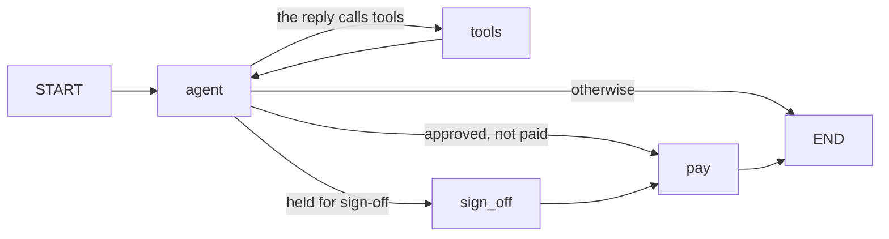

# Plan: durable state

This plan builds the brief in `DURABLE.md` on top of the finished harness, in six phases. Each phase leaves `npm run check` green and is committed before the next one starts.

When it's done, the claim agent is a LangGraph graph that saves its progress in Supabase after every step. An approval over the limit stops and waits for a handler. As soon as a handler signs off on the dashboard, the agent's own web service picks the claim up and pays it. A claim stopped partway carries on from its last step the next time the agent runs, and the backend treats a repeated decision or payment as done, so nothing happens twice. The backend's records live in Supabase too, the claim agent works out payouts with UnderCover's payout rules, and everything that happens on one claim sits in one Langfuse session.

> **Sidenote from the brief:** For consistency with the course, please read `labs/week2day3.ipynb` and build the solution in the same style as the lab. Where the lab and this brief differ, follow the brief. Include this sidenote in your plan too.

## Design

### Following the lab

The claim graph is built the way `labs/week2day3.ipynb` builds it, and differs only where the brief or the product asks for something else.

| As in the lab | Different, and why |
| --- | --- |
| A `ClaimState` TypedDict, with `messages` kept by `add_messages` | Each try at a claim has its own thread id, a new uuid from `start_claim`, not the claim id. A claim that fails with an error must start afresh, so its next try needs a new thread |
| An `agent` node that calls the model with the tools bound, and LangGraph's `ToolNode` | The decision is still recorded with the `record_decision` tool, not a `decide` node with structured output. The backend stays the record, and its refusals (such as a decline with a payout) go back to the model so it can put them right. The brief only takes away `pay_claim` |
| An `after_agent` conditional edge that loops through the tools until the model stops asking for them | Where the lab's `after_decide` compares the payout with `APPROVAL_LIMIT`, our edge reads the claim's status from the backend. The graph never applies the limit itself |
| `interrupt()` in a node of its own, and the payment in another node, so the code before the interrupt is harmless when the node runs again on resume | Paying goes through the backend's `pay_claim`, which treats a repeat as done, in place of the lab's `ON CONFLICT DO NOTHING` |
| `PostgresSaver` with `autocommit=True`, `prepare_threshold=0`, `row_factory=dict_row` and `search_path` set in the connection's options, `setup()`, and `durability="sync"` | A pool of at most 4 connections rather than one connection, and the schema `undercover` rather than `lab` |
| `Command(resume=...)` to carry on after a sign-off, and `get_state(...).next` and `.interrupts` to see where a thread stopped | The model is DeepSeek V4.1 Flash through `ChatDeepSeek`, and the instructions come from the backend, as they do today |

### The claim graph

**State.** `messages` (with `add_messages`), `claim_id`, `model_calls` and, once signed off, `signed_off_by`. The checkpointer saves it after every step.

**Nodes.** They take over the middleware's jobs:

| Node | What it does | In place of |
| --- | --- | --- |
| `agent` | Calls the model with the claim's instructions and the conversation so far, records the reply on the claim as steps (its text and each tool call), and adds one to `model_calls`. When `model_calls` has reached 30 it raises instead of calling the model. A `RetryPolicy` on the node retries a failed model call twice | `ModelCallLimitMiddleware`, `ModelRetryMiddleware` and the step recording in `work.py` |
| `tools` | LangGraph's `ToolNode` over the claim agent's tools. `handle_tool_errors` hands a backend refusal back to the model as `Refused: ...`. `wrap_tool_call` records each result on the claim, a section read as a `read` step | `ToolErrorMiddleware` and the step recording |
| `sign_off` | `interrupt()` with the claim id and payout. On resume it returns the handler's name into `signed_off_by` | New |
| `pay` | Pays the approved payout through `pay_claim` and records the call and the backend's reply as steps, as the model's `pay_claim` calls were recorded before | The claim agent's `pay_claim` tool |

**Edges.** After `agent`: to `tools` when the reply calls tools. Otherwise the edge reads the claim from the backend: held for sign-off goes to `sign_off`, an approval not yet paid goes to `pay`, and anything else (a decline, a referral, or no decision at all) ends. `sign_off` goes to `pay`, and `pay` ends.

Because `model_calls` is in the saved state, the cap of 30 holds across a restart: a claim stopped at 25 calls gets 5 more, not 30.

Every run of the graph passes `durability="sync"`, so each step is saved before the next one starts.

### Claim states

The states stay the same. Only what `in_progress` covers changes: an approval is decided once it's paid.

| State | Meaning |
| --- | --- |
| `waiting` | In the queue, not started, or back after one failure |
| `in_progress` | The agent is working on it, or is about to pay it: an approval within the limit until it's paid, and an approval over the limit from the sign-off until it's paid |
| `waiting_for_sign_off` | Approved over the limit, waiting for a handler |
| `decided` | Declined, referred, or approved and paid |
| `left_for_handler` | Failed twice before it was decided |

### Who guarantees what

| Rule from the brief | Enforced by |
| --- | --- |
| No payout over the limit without a sign-off, whatever the agent does | The backend's `pay_claim` returns 403 until the decision is signed off |
| No claim decided twice | `record_decision` returns the claim when the same decision and payout are already recorded, and 409 for a different one |
| No claim paid twice | `payments` keeps one row per claim, and `pay_claim` returns the claim when it's already paid |
| The graph waits only when the backend says so | The edge after `agent` reads the claim's status, never the limit |
| A sign-off reaches the agent only once it's saved, and stands if the agent can't be reached | The backend calls the agent's service after the sign-off is committed, and logs and ignores a failed call |
| A claim stopped partway isn't a new attempt | Carrying on resumes the claim's own thread without `start_claim`, so the thread id and the failure count stay as they were |
| A claim that fails with an error starts afresh | As today: `record_failure` puts it back in the queue, and `start_claim` gives the next try a new thread |
| A claim with a decision is never put back in the queue | `record_failure` returns 409 for a claim with a decision |
| At most 30 model calls on a claim | `model_calls` in the saved state |
| At most 4 database connections in each process | SQLAlchemy's pool of 4 with no overflow in the backend, and a `ConnectionPool` of at most 4 for the checkpointer in each agent process |

### Picking a claim back up

| Situation | The claim | Its thread | What happens |
| --- | --- | --- | --- |
| Stopped partway (a crash, a restart, Ctrl-C) | `in_progress`, no sign-off | A next node is pending | `invoke(None, ...)` carries on from the last saved step |
| Stopped before its first step was saved | `in_progress` | No checkpoint | The graph starts on the same thread |
| Waiting for a handler | `waiting_for_sign_off` | Interrupted at `sign_off` | Nothing until a handler signs off |
| Signed off | `in_progress`, signed off | Interrupted at `sign_off` | `Command(resume={"signed_off_by": ...})`, then `pay` |
| Failed with an error | `waiting` | Left behind | Starts afresh on a new thread, as today |

Two things pick claims back up, both through `work.carry_on`:

- **The agent's service**, as soon as the backend tells it about a sign-off.
- **`uv run -m agent`**, when it starts. Before a run it finishes a run that was stopped, with a summary saying so, then carries on with every claim in progress and prints a line for each. These claims were taken on by an earlier run, so they don't count against the new run's cap. `uv run -m agent CLM-1008` carries that claim on if it's in progress, and starts it if it's waiting.

The service only picks up the claims it's told about; it doesn't look for stopped claims when it starts. That's the run's job.

### The agent's service

`agent/service.py` is a small FastAPI app, the agent's entry point, which `npm run dev` starts on port 8002 beside the backend and the dashboard. Its operations follow the same API rules as the backend's.

| Operation | Route | What it does |
| --- | --- | --- |
| `resume_claim` | `POST /api/claims/{claim_id}/resume` | Returns 202 at once, then carries on with the claim in a background task, one claim at a time, and prints its line |
| `health` | `GET /api/health` | Checks that the service is running |

The endpoint and the work are synchronous, so the sync checkpointer runs in FastAPI's thread pool and never needs Windows' event loop to support async Postgres.

The backend reaches it through `backend/agent_client.py`, the one place that knows its address: `UNDERCOVER_AGENT`, or `http://127.0.0.1:8002`.

### The database

- **One set of queries.** `backend/database.py` declares the tables once with SQLAlchemy Core, and every router writes its queries with Core. The SQLite view `claim_view` becomes one Core `select` in `claims.py`. Timestamps stay ISO text and records stay JSON text, so rows look the same on both databases.
- **Which database.** `engine()` builds a `postgresql+psycopg` engine from `DATABASE_URL` when it's in the environment, and otherwise SQLite at `UNDERCOVER_DB` or `undercover.db`. On Postgres, `connect_args={"options": "-c search_path=undercover"}` puts every query in the `undercover` schema, so the same queries work on SQLite, and `pool_size=4, max_overflow=0` caps the connections. SQLite opens the file for each request (`NullPool`), as before, so the file can be replaced while the backend runs.
- **Waiting for a connection.** A request holds its connection across more than one of FastAPI's threads: the endpoint runs in one, and its response is checked in another before the request's connection is committed and returned. When requests waited for one of the four connections inside a thread, 50 requests at once took every thread while the four holding connections waited for one, and a quarter of them timed out after 30 seconds. So `database()` depends on `connection_slot()`, which waits on a semaphore of four without holding a thread.
- **Who gets `.env`.** The backend reads no `.env` itself. `npm run dev` and `npm run seed` pass it with `uv run --env-file .env`. The tests and Playwright never do, so they stay on SQLite with no network.
- **Seeding.** On Postgres, seeding creates the `undercover` schema if it's missing, drops our tables, creates them again and fills them. It leaves the checkpointer's tables alone: every try has a new thread id, so an old thread is never picked up again. The backend seeds on startup when the database has no `claims` table.
- **New columns.** `decisions.signed_off_by` and `decisions.signed_off_at` hold the sign-off. `payments.signed_off_at` joins `payments.signed_off_by`, so the payment records who signed off and when.

**The checkpointer.** `harness.checkpointer()` is one `PostgresSaver` per process, on a `psycopg_pool.ConnectionPool` from `DATABASE_URL` with at most 4 connections and the lab's settings plus `search_path=undercover`. It runs `setup()` the first time. The agent needs `DATABASE_URL`; `uv run -m agent` loads `.env` when it starts, and `npm run dev` passes it to the service. The tests swap the checkpointer for one `InMemorySaver` per test, so "a restart" is a new graph on the same saver.

**Connections at once,** against the free plan's 15:

| Process | At most |
| --- | --- |
| The backend | 4 |
| The agent's service | 4 |
| A run of `uv run -m agent` | 4 |
| In all | 12 |

### Tracing

- Each piece of work on a claim is one Langfuse trace, `work-claim`: working it from the start, carrying it on after a stop, or paying it after a sign-off. Each one is in the session `<claim id>:<thread id>`, such as `CLM-1008:3f6c...`, set with Langfuse's `propagate_attributes`. The trace that stops at the sign-off and the trace that pays after it share a session, so the claim reads as one story in Langfuse's Sessions view.
- A queue run stays one trace, `run-queue`, with the queue agent, its model calls and its tools. A trace can only be in one session, so a claim worked through the run's `work_claim` starts a trace of its own rather than nesting under that call. LangGraph merges the callbacks of the run a graph is started in, so `harness.trace_claim` does a claim's work in a fresh `contextvars.Context()`, where it is a run of its own.
- `harness.tracing()` stays the one Langfuse handler, and each model call still records what OpenRouter charged.

### The payout rules

`backend/payout_rules.py` takes the rules in `labs/week2day1_payout.py` into the backend: each line's limit (items, electronics with Electronics Plus, hotels, meals without receipts), cash up to $100 in all, less what others paid, the deductible, the benefit's maximum (capped at the trip cost for cancellation and interruption), and never below zero. The plans come from `data/plans.json`, as in the lab. Whether a payout needs a sign-off uses the approval limit in the `settings` table, which seeding takes from `data/company.json`, in place of the lab's fixed `APPROVAL_LIMIT`.

`calculate_payout` (`POST /api/payouts`) runs them. Its body is `{policy_id, benefit, lines, paid_by_others}` and each line is `{description, amount, quantity, kind, nights, hours}`. The API has no optional inputs, so every field is required: `quantity` is 1, and `nights`, `hours` and `paid_by_others` are 0 when they don't apply. The tool's descriptions say so. It returns `{calculation, payout, needs_sign_off}`.

The claim agent gets a `calculate_payout` tool. Its instructions say to work out an approval's payout with it and record the payout it returns.

### API

New and changed operations. Every operation keeps an `operation_id`, a one-line docstring and no optional inputs.

| Operation | Route | What changes |
| --- | --- | --- |
| `calculate_payout` | `POST /api/payouts` | New. 404 for an unknown policy, 422 for an unknown benefit or kind, a quantity below 1 or a missing field |
| `record_decision` | `POST /api/claims/{claim_id}/decision` | The same decision and payout again returns the claim. A different one returns 409. An approval within the limit stays in progress until it's paid |
| `pay_claim` | `POST /api/claims/{claim_id}/payment` | Returns the claim, not the payment. A repeat returns the claim. Pays an approval over the limit only once it's signed off, copies the sign-off onto the payment and moves the claim to decided |
| `sign_off_claim` | `POST /api/claims/{claim_id}/sign-off` | Records who signed off and when, moves the claim to in progress and no longer pays. Then the backend asks the agent's service to pick the claim up |
| `record_failure` | `POST /api/claims/{claim_id}/failure` | 409 for a claim with a decision |
| `get_claim`, `list_claims` | | A decision gains `signed_off_by` and `signed_off_at`, and a payment gains `signed_off_at` |

### Modules

The agent's modules still depend on each other in one direction: `api` ← `tools` ← `harness` ← `work` ← `service` and `__main__`.

| Module | | Its one job | Imports |
| --- | --- | --- | --- |
| `backend/database.py` | changed | The tables in SQLAlchemy Core, the engine for SQLite or Supabase, and a connection for each request | `sqlalchemy`, `fastapi`, `anyio` |
| `backend/settings.py` | new | UnderCover's settings from the database: the approval limit | `database` |
| `backend/payout_rules.py` | new | The payout rules, as plain functions | `models`, `data/plans.json` |
| `backend/policies.py` | new | Finds a policy, for the two routers that need one | `database`, `models` |
| `backend/payouts.py` | new | The router for `calculate_payout` | `database`, `settings`, `policies`, `payout_rules`, `models` |
| `backend/agent_client.py` | new | The one client for the agent's service | `httpx` |
| `backend/claims.py` | changed | The router for the queue and the work on each claim | `database`, `settings`, `models`, `agent_client` |
| `backend/records.py`, `documents.py`, `runs.py` | changed | Their routers as today, with Core queries; `records` finds a policy through `policies` | `database`, `models`, `policies` |
| `backend/seed.py` | changed | Rebuilds the database, SQLite or Supabase, from `data/` | `database` |
| `backend/models.py` | changed | Adds the payout shapes and the sign-off fields | `pydantic` |
| `backend/main.py` | changed | Creates the app, adds the payouts router, seeds when there's no `claims` table | the routers, `database`, `seed` |
| `agent/api.py` | changed | Adds `calculate_payout`; `pay_claim` returns the claim | `httpx` |
| `agent/tools.py` | changed | Adds `calculate_payout`; the claim agent loses `pay_claim` | `api` |
| `agent/harness.py` | changed | The model, the claim graph and the queue agent with its middleware, the checkpointer, tracing, recording steps, and running them | `api`, `tools`, LangGraph, LangChain, Langfuse, `psycopg_pool` |
| `agent/work.py` | changed | The work: start a claim, carry one on, catch up after a stop, run the queue | `api`, `harness`, `tools` |
| `agent/service.py` | new | The agent's web service | `work`, `fastapi` |
| `agent/__main__.py` | changed | The command line; loads `.env` and catches up before a run | `api`, `work` |
| `dashboard/src/api.ts`, `components/DecisionPanel.tsx` | changed | The sign-off fields, and the sign-off and payment lines | |
| `e2e/agent-stand-in.mjs` | new | A stand-in for the agent's service on port 8003 that records the claims it's asked to resume | `node:http` |
| `e2e/api.ts`, `playwright.config.ts` | changed | Reading the stand-in's record; starting it and pointing the test backend at it | |

`docs/CODE_STANDARDS.md` rule 10 is updated to name the service as the agent's fourth part, and the graph's nodes in the harness in place of the middleware.

### Fixing the code before building on it

1. `agent/harness.py` loads `.env` when it's imported. Once `.env` holds `DATABASE_URL`, any test that imports the agent would point the backend under test at Supabase. Loading `.env` moves to `uv run -m agent`'s entry point, and `npm run dev` passes it to the processes it starts.
2. `approval_limit` lives in `claims.py`, and the payout operation needs it too. It moves to `backend/settings.py` (rule 7).
3. `claim_view` is a SQLite view, which would need writing twice. It becomes one Core `select`.
4. `steps()` and `record_steps()` are in `work.py`, but the graph's nodes record the steps now. They move to `harness.py`.
5. `work_claim` decides whether the agent finished by the claim's status. With an approval in progress until it's paid, it checks whether a decision was recorded instead.

### Dashboard

- **Claim page.** A claim in progress with an approval says "The agent is paying this claim", after "Signed off by Dana Whitfield at 14:02" when it was signed off. A payment says "Paid $1,350.00, signed off by Dana Whitfield at 14:02". The sign-off form is unchanged; after it the page shows In progress, then Decided once the agent has paid, through its usual refresh every two seconds.
- Nothing else changes.

### Docs

`docs/SPEC.md`'s section on working the queue describes the wait for a sign-off, picking the claim back up and paying it, carrying on after a stop, and finishing a stopped run. Its Rules stay as they are. `docs/TECH_STACK.md`, `docs/PROCESS.md` and `docs/STATUS.md` describe the product as it now is.

### How the criteria are checked

As before: API calls against `npm run dev`, and pages in the browser with the Playwright MCP server. Supabase's tables and connections are checked through the Supabase MCP server, which is read-only. Langfuse is checked through its API with a short `uv run python -c` that uses `get_client().api`. Tests never call a model; they use stub models. Only the criteria marked "Live" use the real model, and every live run starts with a reseed and works at most five claims.

## Phase 1: The payout rules, and a Langfuse session for each claim

Bring the payout rules into the backend as `calculate_payout`, and give the claim agent a tool for them. Move `approval_limit` to `backend/settings.py`. Make each claim's work a trace of its own in its session. Still on SQLite and `create_agent`.

- [x] pytest covers `payout_rules`: each kind of line and its limit, cash up to $100 in all, less what others paid, the deductible only for baggage and emergency medical, the benefit maximum and the trip-cost cap, and a payout never below zero
- [x] pytest: a payout of exactly the limit needs no sign-off and one cent over does; with the limit in `settings` changed to 500, a payout of $600 needs a sign-off
- [x] `curl -s -X POST localhost:8000/api/payouts` for `POL-2007` (Economy), baggage, a $239.99 suitcase (item) and three T-shirts for $74.97 (quantity 3), with $100 paid by others, returns a payout of 24.97, `needs_sign_off` false, and the steps "Hard-shell suitcase, limited to $150.00", the T-shirts at 74.97, -100 paid by others and -100 deductible
- [x] A $1,200 hospital bill on `POL-2006` (First), emergency medical, returns 1200.00 with `needs_sign_off` true
- [x] An unknown policy returns 404. A quantity of 0, an unknown kind and a missing `hours` each return 422
- [x] The OpenAPI test passes with `calculate_payout`
- [x] The tools test: the claim agent's tools include `calculate_payout`, named after the backend operation
- [x] Stub model test: the stub calls `calculate_payout`, then records the payout it got back. The steps hold the call and the calculation
- [x] `backend/instructions/claim.md` says to work out an approval's payout with `calculate_payout`, as a goal rather than a step-by-step script
- [x] Tracing test: a claim worked on its own is one `work-claim` trace in the session `CLM-1001:<its thread id>`
- [x] Tracing test: in a run of two claims, the `run-queue` trace holds the queue agent and both `work_claim` calls but no claim agent, and each claim's work is a trace of its own, in its own session
- [x] Live: after `uv run -m backend.seed`, `uv run -m agent CLM-1011` prints a line, and its steps include a `calculate_payout` call
- [x] Live: through Langfuse's API, the session `CLM-1011:<its thread id>` holds one `work-claim` trace with a `calculate_payout` observation
- [x] `npm run check` passes

## Phase 2: Our records on Supabase

`uv add sqlalchemy`. Rewrite `database.py` with Core tables and the engine for SQLite or Supabase, and every query in Core. Seed either database. Move loading `.env` out of the harness. `npm run dev` passes `.env` to the backend, and `npm run seed` reseeds Supabase.

- [x] Every existing backend and agent test passes on SQLite, unchanged apart from the fixtures
- [x] pytest: with no `DATABASE_URL`, the engine is SQLite at `UNDERCOVER_DB`. With `DATABASE_URL` set to a Postgres URL, it's a `postgresql+psycopg` engine with a pool of 4, no overflow and `search_path=undercover`, built without connecting
- [x] `grep -rn "sqlite3" backend --include=*.py` finds nothing outside the tests, and no router passes SQL text to `execute`
- [x] `grep -rn load_dotenv agent backend` finds it only in `agent/__main__.py`: the import at the top, and the call under `if __name__ == "__main__":`
- [x] `npm run seed` prints the seeded counts. Through the Supabase MCP server, the `undercover` schema holds `claims`, `customers`, `decisions`, `handlers`, `payments`, `policies`, `runs`, `sections`, `settings` and `steps`, with 25 claims all waiting, and `lab` is untouched
- [x] `npm run seed` a second time works and leaves 25 waiting claims
- [x] With `npm run dev`: `curl -s localhost:8000/api/claims` returns 25 claims. Starting `CLM-1001` and recording a step with `curl` shows both in Supabase through the MCP server, and `npm run seed` puts them back
- [x] With `npm run dev` and a burst of 50 parallel requests, the backend adds at most 4 connections to the `postgres` connections in `pg_stat_activity`
- [x] With `.env` in place, `npm run check` passes and leaves `undercover.steps` in Supabase as it was. With `.env` moved out of the way, `npm run check` passes
- [x] `npm run check` passes

## Phase 3: Waiting, paying and nothing twice, in the backend

Change the backend's rules: a repeated decision or payment counts as done, an approval is decided once paid, and a sign-off records who and when, moves the claim to in progress and asks the agent's service to pick it up. Add `backend/agent_client.py`. Show the sign-off on the claim page. The end-to-end tests get a stand-in for the agent's service on port 8003. Until phase 5 there's no service on 8002, so a sign-off's call fails and the sign-off stands.

- [ ] pytest: `record_decision` with the same decision and payout again returns 200 and the claim, with one decision. A different decision returns 409, and the first stands
- [ ] pytest: a decline or a referral is decided at once. An approval within the limit stays in progress until it's paid, then is decided
- [ ] pytest: `pay_claim` returns the claim. Paying again with the same amount returns 200 and the claim, with one payment. A wrong amount returns 422, a claim that isn't approved 409, and an approval over the limit with no sign-off 403
- [ ] pytest: a sign-off moves the claim to in progress, with `signed_off_by` "Dana Whitfield", a `signed_off_at` time and no payment. Paying it then decides it, and the payment has the same `signed_off_by` and `signed_off_at`
- [ ] pytest: a sign-off asks the agent's service to resume the claim exactly once, and when it does, the sign-off is already saved in the database
- [ ] pytest: with `UNDERCOVER_AGENT` pointing at a port nothing listens on, a sign-off returns 200 and stands
- [ ] pytest: a second sign-off returns 409. An unknown handler returns 404, and a handler who can't sign off returns 403, as before
- [ ] pytest: `record_failure` on a claim with a decision returns 409
- [ ] The backend's tests never reach a real agent's service: they replace `agent_client` with a recorder
- [ ] Stub model test: `work_claim` reports a claim with a decision without recording a failure
- [ ] The OpenAPI test passes
- [ ] `grep -rn "UNDERCOVER_AGENT\|/resume" backend --include=*.py` finds them only in `backend/agent_client.py` and the tests
- [ ] vitest: the decision panel for a claim in progress with a sign-off shows "Signed off by Dana Whitfield at" a time and "The agent is paying this claim". A payment with a sign-off shows the handler and the time
- [ ] e2e: the test holds `CLM-1020` for sign-off through the API, and the handler signs off on the claim page. Without a reload, the page shows In progress and "Signed off by Dana Whitfield", and the stand-in on port 8003 has been asked to resume `CLM-1020` once. The test then pays through the API, standing in for the agent, and the page shows Decided and "Paid $1,350.00, signed off by Dana Whitfield at" a time
- [ ] e2e: the existing tests still pass, including the claim page showing the agent at work
- [ ] `npm run check` passes

## Phase 4: The claim agent as a graph that waits and carries on

Build the claim graph in `agent/harness.py`, with the Postgres checkpointer and `durability="sync"`. The claim agent loses `pay_claim`, and `claim.md` changes to match. Build `work.carry_on` and the catch-up before a run, and `uv run -m agent CLM-1008` carries on a claim in progress. Each carry-on is a trace in the claim's session.

- [ ] A pytest test checks the claim agent's tools are exactly `get_claim`, `get_policy`, `get_claim_history`, `list_sections`, `search_documents`, `read_section`, `calculate_payout` and `record_decision`
- [ ] A pytest test checks the graph's nodes are `agent`, `tools`, `sign_off` and `pay`, with the edges in the design
- [ ] Stub model test, within the limit: the stub approves $420 on `CLM-1001` and finishes. The `pay` node pays it once, the claim is decided, and the steps end with the graph's `pay_claim` call and its result
- [ ] Stub model test, the pause: the stub approves $1,350 on `CLM-1002`. The graph stops with `next` of `("sign_off",)` and an interrupt holding the claim id and payout. The claim is waiting for sign-off with no payment, and the line ends "waiting for sign-off"
- [ ] Stub model test, the sign-off: after a handler signs off through the API, `carry_on` with a new graph on the same checkpointer pays the claim once, signed off by the handler at the sign-off time, with no model call. A second `carry_on` changes nothing
- [ ] Stub model test, stopped partway: the stub stops the process (`KeyboardInterrupt`) on its third call. The claim stays in progress. `carry_on` with a new graph and a new stub carries on: the stub's first prompt holds the conversation from before the stop, the thread id is unchanged, there's no `error` step, the failure count is 0, the steps from before aren't recorded again, and there's one decision
- [ ] Stub model test: a claim stopped after `start_claim` and before its first step was saved starts on the same thread
- [ ] Stub model test, stopped while paying: `pay_claim` pays and then the process stops. `carry_on` runs `pay` again, which counts as done: one payment, and the claim is decided
- [ ] Stub model test, an error: the model fails. The claim goes back in the queue, and the next `work_claim` starts it on a new thread, with only the task in the stub's first prompt
- [ ] Stub model tests carried over: a refusal reaches the model as `Refused: ...` and is recorded as a `tool_result`; a section read is a `read` step; a failed model call is retried twice; a claim agent that keeps calling tools is stopped at 30 model calls and its claim goes back in the queue
- [ ] Stub model test: a claim stopped at 25 model calls is stopped after 5 more when carried on
- [ ] Stub model test: the run's catch-up finishes a stopped run with a summary saying it was stopped, carries on each claim in progress and prints a line for each, and those claims don't count against the new run's cap
- [ ] Tests cover the command line: with claims in progress and none waiting, `uv run -m agent` carries them on and says no claims are waiting; a claim id in progress is carried on; a claim id waiting is started
- [ ] Tracing test: the trace that stops at the sign-off and the trace that pays after it are two `work-claim` traces in the same session
- [ ] `grep -n pay_claim backend/instructions/claim.md` finds nothing
- [ ] Live: after `npm run seed`, with `npm run dev` running, `uv run -m agent CLM-1008` prints a line ending "waiting for sign-off", and through the Supabase MCP server `undercover.checkpoints` holds rows for its thread
- [ ] Live: a sign-off with `curl` (`HND-01`) moves `CLM-1008` to in progress, signed off. The call to the agent's service fails, since it isn't built yet, and the sign-off stands
- [ ] Live: `uv run -m agent CLM-1008` again prints "approve" and "paid". The claim is decided with one decision, the same thread id, and a payment signed off by Dana Whitfield with the time
- [ ] Live: through Langfuse's API, the session `CLM-1008:<its thread id>` holds two `work-claim` traces, the second with the `pay` node
- [ ] `npm run check` passes

## Phase 5: The agent's service

Build `agent/service.py`, and have `npm run dev` start it on port 8002 with `.env`, next to the backend and the dashboard. Update rule 10 in `docs/CODE_STANDARDS.md` and the running instructions in `docs/PROCESS.md`.

- [ ] pytest: the service's operations each have an `operation_id`, a one-line docstring and no optional inputs
- [ ] Stub model test: with `CLM-1002` paused for sign-off and signed off through the backend, `POST /api/claims/CLM-1002/resume` on the service returns 202, and the background work pays the claim once, signed off by the handler. A second call changes nothing
- [ ] `npm run dev` starts the backend on port 8000, the agent's service on port 8002 and the dashboard on port 5173, on Windows, and `curl -s localhost:8002/api/health` returns `{"status": "ok"}`
- [ ] Live: after `npm run seed`, with `npm run dev` running, `uv run -m agent CLM-1008` waits for sign-off. Within five seconds of a sign-off with `curl`, `curl -s localhost:8000/api/claims/CLM-1008` shows it decided and paid, signed off by Dana Whitfield with the time, and the service's console shows its line
- [ ] `docs/CODE_STANDARDS.md` names the service as the agent's fourth part, and `docs/PROCESS.md` says what `npm run dev` and `npm run seed` start
- [ ] `npm run check` passes

## Phase 6: A trial on five claims

Run the whole product on the real model against Supabase, capped at five claims, sign off on the dashboard, kill a run partway, and bring the docs up to date.

- [ ] Live: after `npm run seed`, with `npm run dev` running, `uv run -m agent --limit 5` prints five claim lines and a summary
- [ ] Live: afterwards, `curl -s localhost:8000/api/claims` shows five claims worked, 20 waiting and none in progress. Every approval over $1,000 is waiting for sign-off with no payment, and every other approval is paid exactly its payout
- [ ] Live: checked several times during the run through the Supabase MCP server, `pg_stat_activity` never shows more than 12 connections whose user is `postgres`
- [ ] Live, in the browser: on a claim waiting for sign-off, signing off as Dana Whitfield through the Playwright MCP server shows it Decided within five seconds, without a reload, with "Paid", the amount, "signed off by Dana Whitfield" and the time. `browser_console_messages` shows no errors
- [ ] Live: through Langfuse's API, that claim's session holds a trace from before the sign-off and one from after it
- [ ] Live: after `npm run seed`, `uv run -m agent --limit 1` is stopped with Ctrl-C once its claim's page shows its first steps. The claim stays in progress and the run unfinished
- [ ] Live: the next `uv run -m agent --limit 1` finishes the stopped run with a summary saying it was stopped, and carries on with that claim on the same thread: no `error` step, no new try, the steps from before kept, and one decision
- [ ] `docs/SPEC.md`'s section on working the queue describes the wait for a sign-off and carrying on after a stop, and its Rules are unchanged. `docs/TECH_STACK.md`, `docs/PROCESS.md` and `docs/STATUS.md` describe the product as it now is, including these live runs
- [ ] With `.env` moved out of the way, `npm run check` passes

## Not in this plan

- A handler rejecting a held payout. The brief leaves it for later.
- The agent's service looking for stopped claims when it starts. A run of `uv run -m agent` does that.
- Two agent processes carrying on the same claim at the same moment are not coordinated, beyond the backend's rules that nothing is decided or paid twice.
- The queue agent surviving a restart. It stays on `create_agent` with no checkpointer: a stopped run is finished by the next one, not carried on.
- Working claims in parallel.
- Removing old checkpoints. Reseeding leaves the checkpointer's tables, and old threads are never picked up again.
- Running the tests on Postgres. They stay on SQLite.
- Deploying to the cloud.
